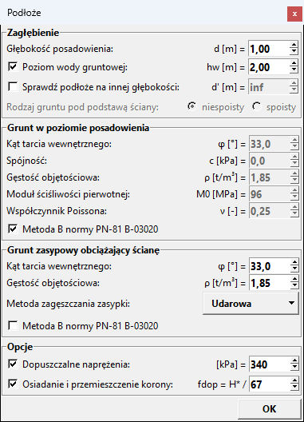
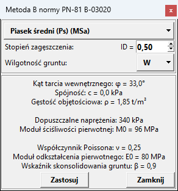
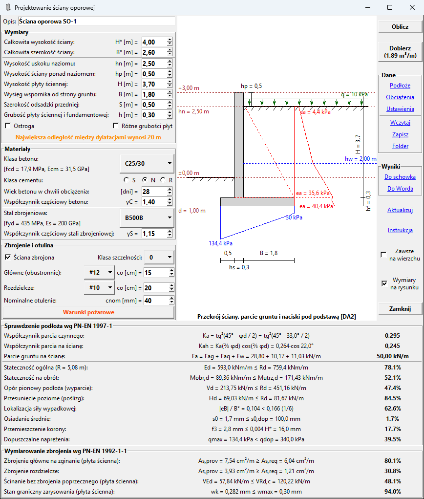
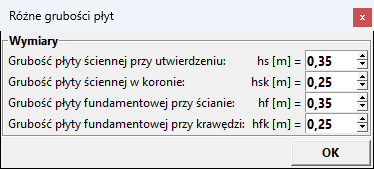
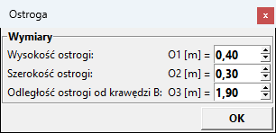
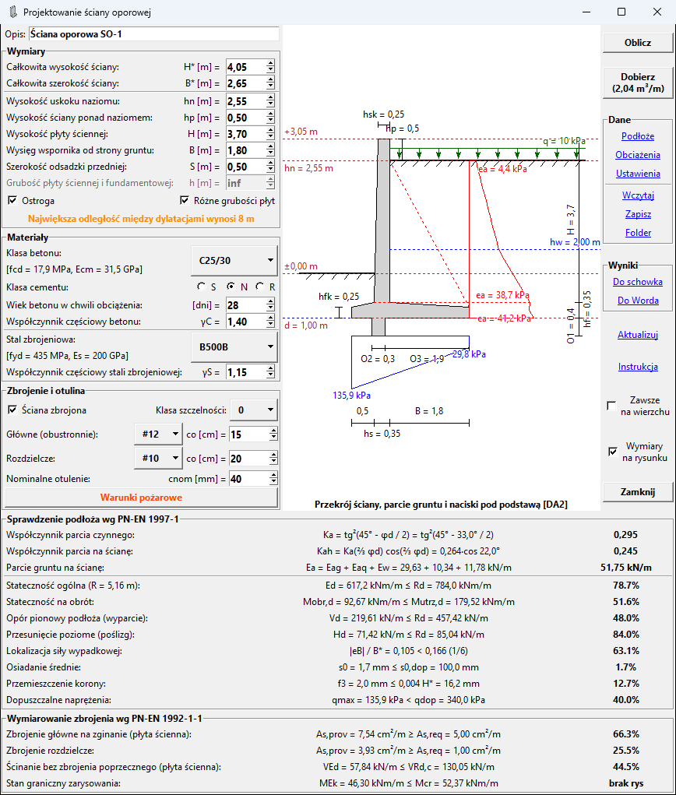
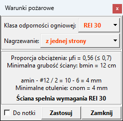
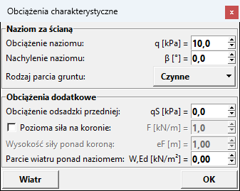
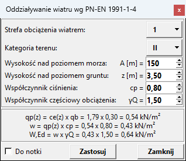
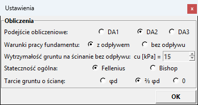

# Ściany oporowe

[Instrukcja](#instrukcja) | [Moduły do ABC](https://pkpkbud.github.io/)

Moduł do szybkiego projektowania żelbetowych ścian oporowych kątowo-płytowych zgodnie
z Eurokodami. Działa samodzielnie, bez modelu w programie **ABC**.

Ściana jest liczona jako pasmo o szerokości 1 m. Moduł sprawdza stany graniczne podłoża
według normy *PN-EN 1997-1* oraz wymiaruje zbrojenie płyty ściennej, wspornika tylnego
i odsadzki według normy *PN-EN 1992-1-1*. Tam, gdzie Eurokod zostawia swobodę, korzysta
z normy *PN-83/B-03010* (parcie od zagęszczania zasypki, stateczność ogólna, osiadania
i przemieszczenie korony). Przed zakupem działa w trybie DEMO, gdzie nie można zmieniać
parametrów podłoża.

## Instrukcja

Podczas korzystania z modułu, można uzyskać wskazówki dotyczące danej funkcji po
najechaniu na opis kursorem myszy. Jednostki, w jakich podane są wartości są po
lewej stronie każdego pola. Wartości można zmieniać, wpisując na klawiaturze i
zatwierdzając klawiszem `Enter`, klikając na znaki `góra`-`dół` po prawej stronie
pola lub wciskając klawisze strzałek `↑`-`↓` na klawiaturze.

### Uruchomienie

Moduł uruchamia się skrótem `Projektowanie ściany oporowej` z pulpitu albo plikiem
`oporowa.exe` z lokalizacji instalacji (np. *C:\ABC6\EXE*). Wszystkie dane podaje się
w oknach modułu. Zapisany wcześniej plik z końcówką *.OPO* można otworzyć od razu,
przeciągając go na skrót modułu.

**Licencję rejestruje się, uruchamiając raz dowolny moduł z poziomu programu ABC**
(także w trybie DEMO), bo tylko wtedy znany jest numer klucza.

### Podłoże

Po uruchomieniu otwiera się okno `Podłoże`. Głębokość posadowienia `d` liczy się od
terenu przed ścianą do poziomu podstawy. Wartość zero oznacza teren przed ścianą
w poziomie podstawy. Pole zmienia kolor na pomarańczowy, gdy zagłębienie jest mniejsze
niż zalecane 0,5 m, a w gruncie wysadzinowym mniejsze niż 0,8 m (najmniejsza głębokość
przemarzania według *PN-81/B-03020*).

Po zaznaczeniu `Poziom wody gruntowej` podaje się głębokość zwierciadła wody poniżej
naziomu za ścianą. Woda daje parcie hydrostatyczne i wypór. Przed ścianą sięga najwyżej
poziomu podstawy (teren odkopany lub odwodniony), a pod podstawą ciśnienie wody zmienia
się liniowo między krawędziami.

Opcja `Sprawdź podłoże na innej głębokości` działa jak w module
[Stopy i ławy](https://pkpkbud.github.io/fundamenty/#podłoże): sprawdza słabszą warstwę
zalegającą płycej niż 2B poniżej podstawy metodą fundamentu zastępczego normy
*PN-81/B-03020*. Ramka gruntu zmienia wtedy nazwę na `Grunt na głębokości d'` i podaje
się w niej parametry tej warstwy.

W ramce `Grunt w poziomie posadowienia` podaje się charakterystyczne parametry gruntu
pod podstawą: kąt tarcia wewnętrznego, spójność, gęstość objętościową, edometryczny moduł
ściśliwości pierwotnej `M0` oraz współczynnik Poissona `ν`. Moduł i współczynnik służą
do obliczenia osiadań i przesuwu podstawy.

W ramce `Grunt zasypowy obciążający ścianę` podaje się parametry zasypki. Zgodnie
z *PN-83/B-03010* zasypka jest z gruntu niespoistego i nie ma spójności.
`Metoda zagęszczania zasypki` określa parcie od zagęszczania według tablicy 9 tej normy:
wibracyjna, statyczna lub udarowa. Domyślna jest udarowa, czyli najniekorzystniejsza.
Przyjęcie łagodniejszej technologii zaleca się zapisać w opisie technicznym.

Opcja `Metoda B normy PN-81 B-03020` w każdej ramce ustala parametry gruntu z zależności
korelacyjnych normy, tak jak w module
[Stopy i ławy](https://pkpkbud.github.io/fundamenty/#podłoże). Po wyborze gruntu
i jego stanu przycisk `Zastosuj` przenosi wartości do okna `Podłoże` i blokuje je.
Dla gruntu pod podstawą przenoszone są także dopuszczalne naprężenia, moduł `M0`
i współczynnik Poissona. Opis opcji zmienia kolor na pomarańczowy, gdy tablica 1 normy
*PN-83/B-03010* wymaga metody A: przy uskoku naziomu ponad 10 m albo przy gruncie słabym
(piasek pylasty luźny, grunt spoisty plastyczny lub miękkoplastyczny).

W ramce `Opcje` można włączyć sprawdzenie `Dopuszczalne naprężenia` oraz
`Osiadanie i przemieszczenie korony`. Graniczne przemieszczenie korony podaje się jako
ułamek całkowitej wysokości ściany `H*`. Norma *PN-83/B-03010* dopuszcza 0,015 H*,
czyli H* / 67. Większy mianownik zaostrza warunek.

### Projektowanie

Po zatwierdzeniu okna `Podłoże` przyciskiem `OK` pokazuje się plansza główna modułu.
Na niej przeprowadzane jest całe projektowanie. Składa się z opisanych poniżej elementów.

**Ramki z danymi po lewej stronie**, gdzie podaje się wymiary, materiały oraz zbrojenie.
`Opis` można dowolnie modyfikować, domyślnie wpisana jest nazwa ściany.

W ramce `Wymiary` całkowita wysokość `H*`, całkowita szerokość `B*` i wysokość uskoku
naziomu `hn` są wymiarami zamiennymi. Po zmianie `H*` lub `hn` przeliczana jest wysokość
płyty ściennej `H`, a po zmianie `B*` wysięg wspornika `B`. `Wysokość ściany ponad
naziomem` `hp` to część płyty ściennej wystająca ponad naziom za ścianą, np. pod
balustradę lub ogrodzenie. Parcie i ciężar gruntu liczy się od naziomu.
`Grubość płyty ściennej i fundamentowej` `h` jest wspólna dla obu płyt.

Zaznaczenie opcji `Różne grubości płyt` otwiera okno, w którym podaje się osobno grubość
płyty ściennej przy utwierdzeniu i w koronie oraz płyty fundamentowej przy ścianie
i przy krawędzi. Płyta ścienna zwęża się od strony odsadzki, a lico od strony gruntu
zostaje pionowe. Góra płyty fundamentowej opada w obie strony od płyty ściennej.
Dwuklik na opcji otwiera okno ponownie.

Zaznaczenie opcji `Ostroga` otwiera okno z wymiarami ostrogi pod płytą fundamentową:
wysokością, szerokością i odległością od tylnej krawędzi podstawy. Ostroga pogłębia
płaszczyznę poślizgu, więc opór na przesunięcie daje ścięcie w gruncie zamiast tarcia
w podstawie, a odpór gruntu stawia cała jej wysokość. Płytę fundamentową przyjmuje się
wtedy jako odkopaną według p. 6.5.3(7)P normy *PN-EN 1997-1*.

Pod wymiarami wyświetlana jest na pomarańczowo największa odległość między dylatacjami
według tablicy NA.1 normy *PN-EN 1992-1-1*, zależna od grubości płyty ściennej: 20 m
do grubości 0,3 m, a przy grubszych płytach od 8 m do 4 m. Moduł nie zna długości
ściany, więc rozstaw dylatacji sprawdza projektant. Zachowanie tej odległości zwalnia
z obliczania wpływu skurczu i temperatury.

W ramce `Materiały` wybiera się klasę betonu, klasę cementu, wiek betonu w chwili
obciążenia (wpływa na pełzanie) oraz stal zbrojeniową. Współczynniki częściowe `γC`
i `γS` można zmienić na wartości dla sytuacji wyjątkowej.

W ramce `Zbrojenie i otulina` podaje się średnice i rozstawy prętów głównych
i rozdzielczych oraz nominalne otulenie. Zbrojenie główne i rozdzielcze układa się
przy obu licach, pręty główne przy powierzchni betonu. `Klasa szczelności` według
*PN-EN 1992-3* ogranicza szerokość rys: w klasie 0 jak dla trwałości, w klasie 1
zależnie od wysokości parcia wody, a w klasie 2 dodatkowo sprawdzany jest zasięg strefy
ściskanej. Odznaczenie opcji `Ściana zbrojona` zmienia ścianę na masywną z betonu
niezbrojonego według rozdziału 12 normy *PN-EN 1992-1-1*.

Przycisk `Warunki pożarowe` otwiera okno, gdzie można sprawdzić i zastosować minimalną
grubość płyty ściennej oraz otulinę zbrojenia metodą tabelaryczną normy
*PN-EN 1992-1-2* (tablica 5.4). Przycisk `Zastosuj` przenosi wymagane wartości do danych.
Zaznaczenie `Do notki` dołącza obliczenia z okna do notki obliczeniowej.

**Rysunek w centralnej części** przedstawia przekrój ściany z poziomami, wykres parcia
gruntu i wody, obciążenie naziomu, płaszczyznę klina odłamu oraz rozkład nacisków
pod podstawą. W tytule rysunku podane jest podejście obliczeniowe. Rysunek można
przybliżać pokrętłem myszy oraz przesuwać trzymając lewy przycisk myszy.

**Ramki z wynikami u dołu**, które aktualizują się po zmianie wartości parametrów lub
po naciśnięciu przycisku `Oblicz`. Każda linijka zawiera opis sprawdzanego warunku,
wzór oraz stopień wytężenia podany w procentach. W przypadku, gdy któryś warunek nie
jest spełniony, kolor tekstu zmienia się na czerwony. Po najechaniu na wzór kursorem
myszy wyświetlane są szczegóły obliczeń. Na końcu wzoru w nawiasie kwadratowym podany
jest decydujący wariant, np. `[bez q]` oznacza wariant bez obciążenia naziomu, które
działa korzystnie, bo dociąża podstawę. Przy podejściu DA1 podana jest też kombinacja.

Najpierw podane są współczynnik parcia oraz parcie gruntu na ścianę jako suma parcia od
gruntu, od obciążenia naziomu i od wody. Przy parciu czynnym jest też współczynnik parcia
na ścianę z uwzględnieniem tarcia gruntu o ścianę. Następnie sprawdzane są warunki
nośności podłoża zgodnie z normą *PN-EN 1997-1*:
- Stateczność ogólna po walcowej powierzchni poślizgu obejmującej ścianę i ostrogę,
metodą pasków według załącznika 3 normy *PN-83/B-03010*. Zawsze według podejścia DA3,
z przeszukaniem środków obrotu i promieni. W opisie podany jest promień
najniekorzystniejszego łuku.
- Stateczność na obrót wokół dolnej krawędzi od strony odsadzki, jako stan graniczny
równowagi EQU.
- Opór pionowy podłoża (wyparcie) obliczony metodą analityczną według załącznika D.
- Nośność na przesunięcie poziome (poślizg) obliczona zgodnie z punktem 6.5.3. Odporu
gruntu przed płytą fundamentową się nie uwzględnia, stawia go tylko ostroga.
- Sprawdzenie, czy siła wypadkowa znajduje się w rdzeniu podstawy. Gdy mimośród
przekracza 1/6 szerokości, w miejscu stopnia wytężenia pojawia się opcja `ODRYWANIE`,
która dopuszcza mimośród do 1/3 i sprawdza zasięg szczeliny pod podstawą według
*PN-81/B-03020*, tak jak w module
[Stopy i ławy](https://pkpkbud.github.io/fundamenty/#projektowanie).
- Osiadanie średnie i przemieszczenie korony według tablicy 12 i załącznika 4 normy
*PN-83/B-03010*, gdy włączono je w oknie [Podłoże](#podłoże). Na przemieszczenie korony
składa się przesuw podstawy, wychylenie od różnicy osiadań krawędzi i ugięcie płyty
ściennej. W wynikach podana jest najbardziej wytężona pozycja tablicy, a wszystkie są
w podpowiedzi.
- Dopuszczalne naprężenia pod podstawą, gdy włączono je w oknie [Podłoże](#podłoże).

W ramce wymiarowania sprawdzane są następujące warunki normy *PN-EN 1992-1-1*,
każdy w najbardziej wytężonym przekroju płyty ściennej, wspornika tylnego lub odsadzki,
podanym w nawiasie:
- Zbrojenie główne na zginanie, wspólne dla całej ściany.
- Zbrojenie rozdzielcze.
- Ścinanie bez zbrojenia poprzecznego.
- Stan graniczny zarysowania według punktu 7.3, uzupełniony normą *PN-EN 1992-3*
w klasach szczelności 1 i 2. Gdy przekrój nie jest zarysowany, podany jest napis
`brak rys`.
- Zasięg strefy ściskanej w klasie szczelności 2.

W ścianie masywnej zamiast zbrojenia sprawdzane jest zginanie z siłą podłużną i ścinanie
płyty ściennej oraz zginanie płyty fundamentowej z betonu niezbrojonego według
rozdziału 12 normy *PN-EN 1992-1-1*.

**Ramka przycisków po prawej** stronie zawierająca następujące funkcje:
- Przycisk `Oblicz` aktualizuje rysunek i część z wynikami dla zadanych wartości.
- Przycisk `Dobierz` szuka najmniejszego wysięgu wspornika `B` przy zadanej szerokości
odsadzki `S`, który spełnia stany graniczne podłoża, a następnie dobiera średnice
i rozstawy prętów. W ścianie masywnej dobiera też grubości płyt. W nawiasie na przycisku
podana jest objętość betonu na 1 m ściany.
- Przycisk `Podłoże` otwiera ponownie wcześniej opisane okno [Podłoże](#podłoże).
- Przycisk `Obciążenia` otwiera opisane niżej okno [Obciążenia](#obciążenia).
- Przycisk `Ustawienia` otwiera opisane niżej okno [Ustawienia](#ustawienia).
- Przycisk `Wczytaj` umożliwia otwarcie pliku z końcówką *.OPO* w celu wczytania
wcześniej zapisanych danych.
- Przycisk `Zapisz` pozwala na zapisanie danych do pliku z końcówką *.OPO* w wybranej
lokalizacji na dysku.
- Przycisk `Folder` pozwala określić domyślny folder do wczytywania i zapisywania
plików z danymi.
- Przycisk `Do schowka` kopiuje listę z notką obliczeniową do schowka. Po zamknięciu
modułu schowek zostaje wyczyszczony.
- Przycisk `Do Worda` otwiera nowy dokument zawierający notkę obliczeniową z rysunkiem.
Ponowne naciśnięcie przycisku powoduje dopisanie wyników do otwartego dokumentu.
W przypadku posiadania innego pakietu niż *Microsoft Office*, jest tworzony i otwierany
nowy plik *WynikiOporowa.docx*.
- Przycisk `Aktualizuj` sprawdza, czy jest uruchomiona aktualna wersja pakietu oraz
w razie potrzeby umożliwia pobranie i aktualizację do najnowszej wersji. Plik
instalacyjny jest pobierany w tle, trzeba poczekać na jego pobranie. Następnie moduł
jest wyłączany i uruchamia się instalacja. Pomarańczowy kolor czcionki przycisku
sygnalizuje, że jest dostępna aktualizacja.
- Przycisk `Instrukcja` otwiera niniejszą stronę internetową z instrukcją modułu.
- Przełączanie opcji `Zawsze na wierzchu` powoduje przypięcie lub odpięcie modułu ponad
innymi oknami.
- Opcja `Wymiary na rysunku` włącza i wyłącza linie wymiarowe.
- Przycisk `Zamknij` pyta o zapisanie danych do pliku i zamyka moduł.

### Obciążenia

W oknie podaje się obciążenia charakterystyczne. Współczynniki częściowe wynikają
z podejścia obliczeniowego wybranego w oknie [Ustawienia](#ustawienia).

W ramce `Naziom za ścianą` podaje się równomierne obciążenie naziomu, które obejmuje
też parcie od zagęszczania zasypki, oraz nachylenie naziomu, nie większe niż kąt tarcia
wewnętrznego zasypki. `Rodzaj parcia gruntu` to parcie czynne dla ściany swobodnej,
mogącej odchylić się od gruntu, albo spoczynkowe dla ściany nieprzemieszczalnej,
np. zwieńczonej stropem.

W ramce `Obciążenia dodatkowe` można podać:
- `Obciążenie odsadzki przedniej`, np. naczepę, kontener lub skład materiałów,
- `Pozioma siła na koronie` działającą w stronę odsadzki, np. odpór bariery
lub uderzenie pojazdu, wraz z wysokością jej przyłożenia ponad koroną,
- `Parcie wiatru ponad naziomem` na część ściany wystającą ponad naziom.

Obciążenia zmienne są pomijane tam, gdzie działają korzystnie, a każdy warunek przyjmuje
gorszy z wariantów z obciążeniem i bez niego.

Przycisk `Wiatr` otwiera okno, gdzie po wprowadzeniu danych dotyczących lokalizacji oraz
obiektu budowlanego, oddziaływanie wiatru według normy *PN-EN 1991-1-4* można przyjąć
przyciskiem `Zastosuj`. Przycisk i pole wiatru są nieczynne, gdy ściana nie wystaje
ponad naziom (hp = 0). Zaznaczenie `Do notki` dołącza obliczenia z okna do notki
obliczeniowej.

### Ustawienia

W oknie wybiera się sposób obliczeń:
- `Podejście obliczeniowe` DA1, DA2 lub DA3 według załącznika A normy *PN-EN 1997-1*.
Zestawy współczynników wchodzą kompletem, a ich wartości podaje podpowiedź i notka.
W Polsce wymagane jest podejście DA2 (domyślne). Przy DA1 każdy warunek przyjmuje
gorszą z dwóch kombinacji.
- `Warunki pracy fundamentu` z odpływem albo bez odpływu. W przypadku wybrania opcji
`bez odpływu` należy podać wytrzymałość gruntu na ścinanie bez odpływu `cu`.
- `Stateczność ogólna` metodą Felleniusa, ostrożniejszą, albo uproszczoną metodą
Bishopa, bliższą rzeczywistości. Obie dopuszcza załącznik 3 normy *PN-83/B-03010*.
- `Tarcie gruntu o ścianę` przy parciu czynnym: `φd` dla betonu układanego bezpośrednio
na gruncie, `⅔ φd` dla lica gładkiego (domyślnie) albo `0` przy izolacji lub
geokompozycie drenażowym na ścianie.
