# Ściany murowe i żelbetowe

[Wideo](#wideo) | [Instrukcja](#instrukcja) | [Moduły do ABC](https://pkpkbud.github.io/)

Moduł do szybkiego projektowania ścian murowych i żelbetowych zgodnie z Eurokodami w
programach **ABC** firmy [PRO-SOFT](https://www.pro-soft.gliwice.pl/). Przed zakupem
działa w trybie DEMO, gdzie nie można zmieniać parametrów materiałowych jak: element
murowy, beton i stal.

## Wideo

<iframe width="560" height="315" src="https://www.youtube.com/embed/CLbIOKY00J4" title="YouTube video player" frameborder="0" allow="accelerometer; autoplay; clipboard-write; encrypted-media; gyroscope; picture-in-picture; web-share" allowfullscreen></iframe>

<iframe width="560" height="315" src="https://www.youtube.com/embed/4C1No9RfA6Q" title="YouTube video player" frameborder="0" allow="accelerometer; autoplay; clipboard-write; encrypted-media; gyroscope; picture-in-picture; web-share" allowfullscreen></iframe>

<iframe width="560" height="315" src="https://www.youtube.com/embed/luqXvd_8IM0" title="YouTube video player" frameborder="0" allow="accelerometer; autoplay; clipboard-write; encrypted-media; gyroscope; picture-in-picture; web-share" allowfullscreen></iframe>

## Instrukcja

Podczas korzystania z modułu, można uzyskać wskazówki dotyczące danej funkcji po
najechaniu na opis kursorem myszy. Jednostki, w jakich podane są wartości są po
lewej stronie każdego pola. Wartości można zmieniać, wpisując na klawiaturze i
zatwierdzając klawiszem `Enter`, klikając na znaki `góra`-`dół` po prawej stronie
pola lub wciskając klawisze strzałek `↑`-`↓` na klawiaturze.

### Uruchomienie

Moduł można uruchomić samodzielnie w trybie kalkulatora. W tym celu należy uruchomić
odpowiedni skrót z pulpitu, alternatywnie plik `mury.exe` lub `zelbet.exe`
z lokalizacji instalacji (np. *C:\ABC6\EXE*). Plik `mury.exe` uruchamia kalkulator
do projektowania ścian murowych, natomiast `zelbet.exe` uruchamia kalkulator do
projektowania ścian żelbetowych.
**Pierwsze uruchomienie należy wykonać z poziomu programu ABC.**

W programach **ABC** dla podpór typu `Ściana` można zaprojektować ścianę murową
lub żelbetową. Odpowiedni moduł uruchamia się w zależności od rodzaju podpory.
W wynikach zadania w menu `Wymiar` dostępna jest opcja `Projektowanie ściany`.
W przypadku, gdy ta możliwość nie jest dostępna trzeba zaktualizować program
**ABC** do wersji 6.24, włączyć pełny zakres menu przyciskiem "M" lub wybrać
z menu opcję `Pokaż → Wybór wymiarowania`.

### Obciążenia

Po uruchomieniu pokaże się pytanie o obciążenia. W przypadku wariantu będzie można
zmienić mnożnik obciążenia, podpowiadany z opisu obciążeń przyjmowanych do obwiedni.
Obwiednia generalnie będzie obliczana jako `Automat EN`, chyba, że są zdefiniowane
własne kombinacje wg PN-EN, to wtedy będzie można je wybrać. Przycisk `Usuń` usuwa
wcześniej zadane miejsca.

### Wybór miejsca

Po zatwierdzeniu obciążeń plansza zostanie zamknięta i pokaże się rysunek modelu.
Pojawią się podpory liniowe typu `Ściana`, należy wybrać dwa skrajne węzły
projektowanego miejsca. Punkty należy wybierać między innymi ścianami, między ścianą
i otworem lub pomiędzy otworami. Alternatywnie, można wybrać dowolne punkty na długości
ściany w celu sprawdzenia wybranego obszaru ściany pod obciążeniem skupionym.

### Usztywnienia

W oknie można wybrać dla każdego z węzłów czy jego krawędź pionowa jest `Podparta`
czy `Swobodna`. Wybór ten ma wpływ na wysokość efektywną ściany i wartości momentów
gnących (schemat statyczny belki w przypadku braku usztywnień lub płyty).
Wybranie podpartej krawędzi włącza długość ściany, bo bez niej podparcie krawędzi
nie ma znaczenia. Dodatkowo, w przypadku ścian murowych, wybór ten wpływa na stan
graniczny użytkowalności (sprawdzenie ograniczenia wysokości i długości ściany
w zależności od jej grubości zgodnie z załącznikiem F normy *PN-EN 1996-1-1*).
Opcja `Ściana obciążona siłą skupioną` pozwala na sprawdzenie wybranego obszaru
ściany pod obciążeniem skupionym, np. w miejscu oparcia belki.

### Projektowanie

Po wprowadzeniu danych na pierwszej planszy można przyciskiem `OK` przejść do planszy
głównej modułu. Odpowiednia plansza otworzy się w zależności od zadanego materiału.
Na niej przeprowadzane jest całe projektowanie. Składa się z opisanych poniżej elementów.

#### Plansza projektowania ściany murowej:

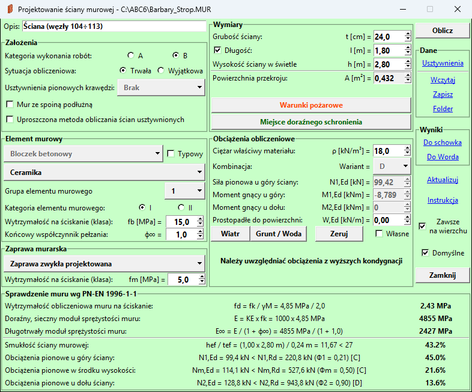

**Ramki z danymi u góry**, gdzie podobnie jak na pierwszej planszy należy podać
wartości, tym razem dotyczące przyjętych założeń projektowych, materiałów, wymiarów
oraz obciążeń obliczeniowych. Opcja `Typowy` pozwala na wybór elementu murowego
z listy i automatyczne uzupełnienie parametrów elementu murowego oraz ciężaru.
Przycisk `Warunki pożarowe` otwiera okno, gdzie można sprawdzić i zastosować minimalną
grubość ściany metodą tabelaryczną normy PN-EN 1996-1-2/AC (załącznik B).

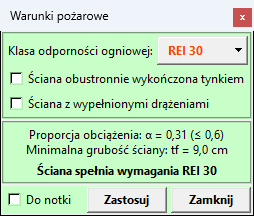

Wszystkie okna dodatkowe mają u dołu ten sam pasek. Zaznaczenie `Do notki` dołącza
obliczenia z okna do notki obliczeniowej, także po jego zamknięciu. Przycisk pośrodku
wykonuje akcję okna, np. `Zastosuj` przenosi wynik do danych ściany. Przycisk
`Zamknij` zamyka okno bez przenoszenia wyniku, a `OK` zamyka okno, którego dane
działają od razu.

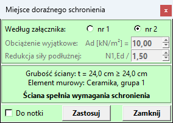

Przycisk `Miejsce doraźnego schronienia` otwiera okno sprawdzenia wymagań
rozporządzenia Ministra Spraw Wewnętrznych i Administracji z dnia 9 lipca 2025 r.
(Dz. U. poz. 932). Rozporządzenie daje do wyboru dwa załączniki:
- `nr 1` - ściana zaprojektowana na obciążenie wyjątkowe `Ad` (domyślnie 10 kN/m²)
działające prostopadle do ściany. Okno pokazuje stopień wytężenia każdego warunku
nośności modułu przy współczynniku materiałowym γM = 1,30. Siły podłużnej
w kombinacji wyjątkowej moduł nie zna, a przy zginaniu działa ona korzystnie, więc
każdy warunek przyjmuje gorszy z przebiegów: z podaną siłą i z siłą podzieloną przez
`Redukcja siły podłużnej`. Wpisuje się tam współczynnik obciążenia: 1,35 przy samych
obciążeniach stałych, 1,50 przy zmiennych (domyślnie), a 2,00 pokrywa kombinację
wyjątkową w całości.
- `nr 2` - element konstrukcyjny przystosowany: ściana grubości co najmniej 24 cm
z elementów pełnych (cegła pełna, bloczki silikatowe lub betonowe pełne, czyli grupa 1S
lub 1). Przycisk `Zastosuj` podnosi grubość do 24 cm, a przy elemencie niepełnym
rozwija listę elementów pełnych do wyboru. Wymagania dotyczą pomieszczeń z podłogą
co najmniej 1,5 m poniżej terenu, na kondygnacji podziemnej lub w garażu podziemnym.

Wymagań dotyczących okien w ścianach zewnętrznych moduł nie sprawdza - przypomina
o nich podpowiedź przy werdykcie. Sprawdzenie jest nieczynne przy ścianie obciążonej
siłą skupioną.

#### Plansza projektowania ściany żelbetowej:

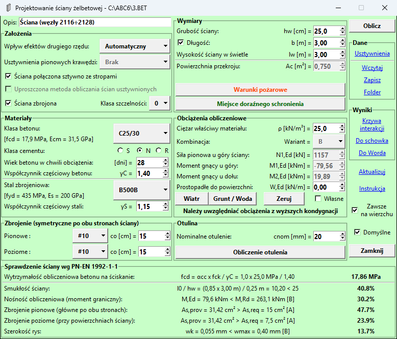

Opcja `Ściana zbrojona` pozwala na zwymiarowanie zbrojenia ściany żelbetowej na
ściskanie ze zginaniem. Jest to rozwiązanie zalecane w przypadku, gdy zostanie
przekroczona wartość dopuszczalnego mimośrodu. Po wybraniu tej opcji odblokuje się
menu `Klasa szczelności`, który pozwala na ograniczenie stanu zarysowania ze względu
na szczelność wg PN-EN 1992-3. W przypadku projektowania ściany w technologii tzw.
"białej wanny" zaleca się wybrać klasę szczelności "1" lub "2", dla których szerokość
rysy ogranicza się w zależności od wysokości parcia hydrostatycznego (0,05÷0,20 mm).
W przypadku wybrania klasy szczelności "2" dodatkowo sprawdzane jest ograniczenie
zasięgu strefy ściskanej, aby wykluczyć powstanie rys na całej wysokości przekroju.
Przycisk `Krzywa interakcji` w menu `Wyniki` po prawej stronie pozwala na pokazanie
nośności przekroju symetrycznie zbrojonego jako zależności siły podłużnej do
granicznego momentu gnącego. Wykres można przybliżać i oddalać za pomocą pokrętła
myszy. Wartości na wykresie można odczytać dowolnym przyciskiem myszy. Przycisk
`Do pliku` pozwala na zapisanie krzywej interakcji jako obrazu w formacie *.PNG*.

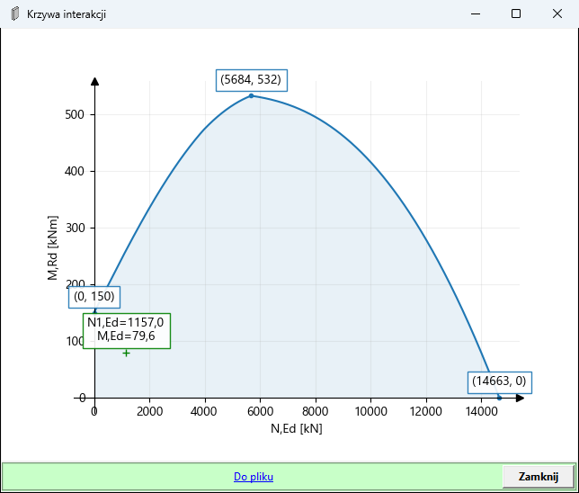

Przycisk `Warunki pożarowe` otwiera okno, gdzie można sprawdzić i zastosować minimalną
grubość ściany oraz otulinę zbrojenia metodą tabelaryczną normy PN-EN 1992-1-2 (p. 5.4.2).

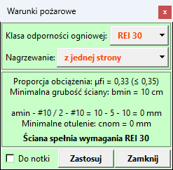

Przycisk `Obliczenie otulenia` otwiera okno, gdzie można sprawdzić i zastosować
nominalne otulenie betonem zbrojenia wg p. 4.4.1 normy PN-EN 1992-1-1 oraz
klasę betonu ze względu na trwałość wg załącznika E normy PN-EN 1992-1-1.

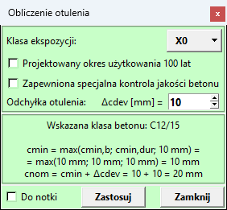

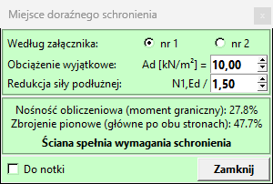

Przycisk `Miejsce doraźnego schronienia` działa jak w ścianie murowej. Przy załączniku
`nr 1` przyjmuje się współczynniki materiałowe dla sytuacji wyjątkowej γC = 1,20
i γS = 1,00. Przy załączniku `nr 2` ściana musi mieć grubość co najmniej 20 cm i być
zbrojona - przycisk `Zastosuj` podnosi grubość do 20 cm i włącza opcję `Ściana zbrojona`.

`Opis` można dowolnie modyfikować, domyślnie wpisane są numery węzłów.
W celu policzenia ściany jako metrowego pasma ściany o nieskończonej długości
należy odznaczyć opcję `Długość`. Przycisk `Wiatr` otwiera okno, gdzie po
wprowadzeniu danych dotyczących lokalizacji oraz obiektu budowlanego,
oddziaływanie wiatru według normy *PN-EN 1991-1-4* można wprowadzić przyciskiem
`Zastosuj` jako obciążenie prostopadłe do powierzchni. Jeżeli jest zadana długość
ściany i nie ma zadanych usztywnień pionowych krawędzi, możemy określić inne niż
długość ściany pasmo zbierania obciążenia od wiatru.

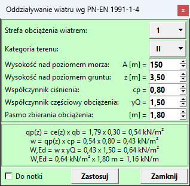

Przycisk `Grunt / Woda` pozwala na zaprojektowanie ścian obciążonych parciem gruntu
i wody prostopadle do swojej powierzchni. Po naciśnięciu otwiera się okno, gdzie można
podać dane gruntu zasypowego, obciążenie obliczeniowe naziomu oraz wysokość parcia
hydrostatycznego (np. poziom wody gruntowej). Ściana oparta na stropie i fundamencie
nie może się przemieścić, więc parcie gruntu jest spoczynkowe, ze współczynnikiem
K0 = 1 - sin φ według p. 9.5.2 normy *PN-EN 1997-1*. Obciążenie naziomu daje trapezowy
wykres parcia, a notka podaje jego wartości u góry i u dołu. Dodatkowe momenty gnące
od parcia gruntu i wody zostaną uwzględnione przy sprawdzaniu nośności na zginanie.
Dane w oknie działają od razu, a okno zamyka się przyciskiem `OK`. Przycisk `Zeruj`
zeruje podane wysokości i obciążenie. Ponowne wciśnięcie przywraca wartości przed
zerowaniem.

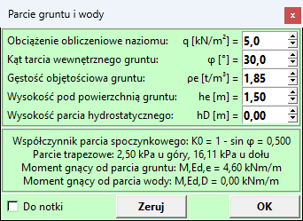

**Siły oraz momenty przyjmowane w module są wyliczone na podstawie obliczeń statycznych.**
**W programie ABC należy uwzględniać ewentualne obciążenia z wyższych kondygnacji.**
Po włączeniu opcji `Własne` wszystkie wartości obciążeń można dowolnie modyfikować oraz
można wybrać wariant z obwiedni sił. W ten sposób można zadać własną siłę skupioną,
np. w przypadku obliczeń wariantu `Ściana pod obciążeniem skupionym` albo można zadać
własne momenty gnące, np. obliczone uproszczoną metodą zgodnie z załącznikiem C normy
*PN-EN 1996-1-1*. Przycisk `Zeruj` zeruje wszystkie podane obciążenia. Ponowne
wciśnięcie przywraca wartości przed zerowaniem. Wymiary ściany oraz materiał są
pobierane z opisu podpory w programie **ABC** lub są przyjmowane wartości domyślne.
Jeżeli podczas definiowania podpory zostanie wybrana opcja `Przegub u góry`
(bez ściany NAD) lub gdy mimośród od obciążeń jest większy niż 0,45 grubości ściany,
przyjmuje się przegubową pracę połączenia ściana-strop i zakłada nie większy niż
0,1 grubości ściany mimośród według (5) załącznika C normy 1996-1-1.

**Ramka z wynikami u dołu**, która aktualizuje się po zmianie wartości parametrów
lub po naciśnięciu przycisku `Oblicz`. Każda linijka zawiera opis sprawdzanego warunku,
wzór oraz stopień wytężenia podany w procentach. Stopień wytężenia większy niż 999%
podawany jest jako `> 999%`. W przypadku, gdy któryś warunek nie jest spełniony, kolor
tekstu zmienia się na czerwony. Nie są również pokazywane sprawdzenia wyników o zerowym
wytężeniu. W przypadku wymiarowania na obwiednię sił, na końcu każdego wzoru w nawiasie
kwadratowym podany jest decydujący przypadek. Po najechaniu na niego kursorem myszy
wyświetlone zostaną wartości sił pobrane z programu **ABC**. Nazwa przypadku oznacza
wiodące obciążenie dla warunku.

W przypadku konstrukcji murowych sprawdzane są następujące warunki nośności zgodnie
z normą *PN-EN 1996-1-1*:
- Smukłość ściany murowej zgodnie z punktem 5.5.1.4.
- Ściana murowa niezbrojona obciążona głównie pionowo zgodnie z punktem 6.1.2
(obciążenia pionowe u góry, dołu lub w środku wysokości ściany) lub w przypadku
wybrania opcji `Uproszczona metoda obliczania ścian usztywnionych` nośność obliczeniowa
sprawdzana jest w sposób uproszczony, metodą podaną w załączniku A normy PN-EN 1996-3.
Aby skorzystać z metody uproszczonej muszą zostać spełnione warunki:
    - wysokość budynku nie przekracza 3 kondygnacji nadziemnych,
    - ściany są usztywnione w kierunku poziomym za pomocą stropów i dachu,
    - stropy i dach opierają się na ≥ 2/3 grubości ściany i nie mniej niż 85 mm,
    - wysokość kondygnacji w świetle nie przekracza 3,0 m,
    - minimalna długość ściany wynosi ≥ 1/3 jej wysokości,
    - obciążenie charakterystyczne zmienne na stropie i dachu poniżej 5,0 kN/m²,
    - maksymalna rozpiętość stropu i dachu w świetle wynosi 6,0 m.
- Ściana murowa niezbrojona obciążona prostopadle do swojej powierzchni zgodnie
z punktem 6.3.1 (zginanie równolegle lub prostopadle do spoin wspornych).

Gdy wypadkowa wychodzi poza przekrój ściany, zamiast wzoru wyświetlany jest napis
`PRZEKROCZONY MIMOŚRÓD`, a gdy siła pionowa jest skierowana do góry - `ODRYWANIE`.
Stopień wytężenia podawany jest wtedy jako `> 999%`.

Jeżeli została wybrana opcja `Ściana obciążona siłą skupioną` sprawdzany jest warunek
nośności ściany obciążonej siłą skupioną zgodnie z p. 6.1.3 normy *PN-EN 1996-1-1*:

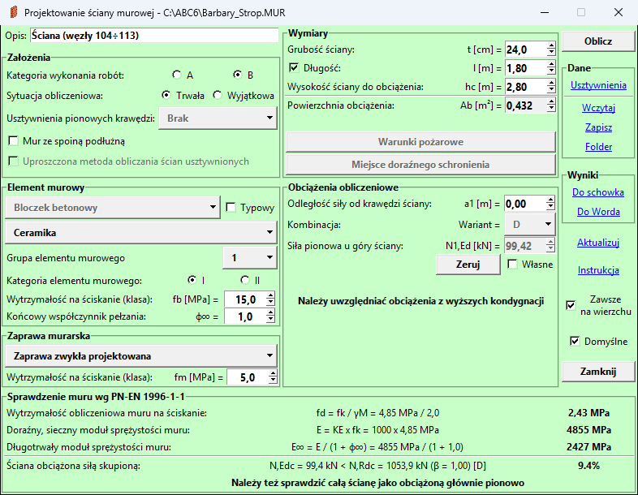

W przypadku konstrukcji z betonu sprawdzane są następujące warunki nośności zgodnie
z normą *PN-EN 1992-1-1*:
- Smukłość ściany zgodnie z punktem 12.6.5.1(5).
- Nośność obliczeniowa ze względu na moment zginający i siłę podłużną zgodnie
z punktem 12.6.1 (obciążenia pionowe u góry, dołu lub w środku wysokości ściany) lub
w przypadku wybrania opcji `Uproszczona metoda obliczania ścian usztywnionych`
nośność obliczeniowa sprawdzana jest w sposób uproszczony zgodnie z punktem 12.6.5.2.

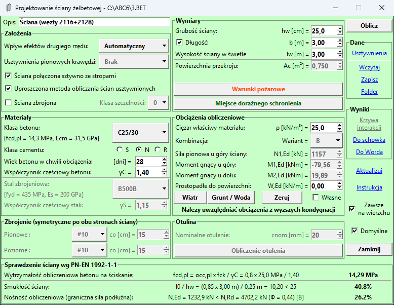

Po włączeniu opcji `Ściana zbrojona` sprawdzane są następujące warunki normowe:
- Nośność obliczeniowa jako moment graniczny przekroju symetrycznie zbrojonego według
wytycznych podanych w punkcie 6.1. Przyjmowany jest prostokątny rozkład naprężeń jak
w punkcie 3.1.7(3).
- Wymagane zbrojenie wynikające z sił wewnętrznych oraz reguł podanych w punkcie 9.6.
Ze względów praktycznych zbrojenie przyjmowane jest jako symetryczne po obu stronach
oraz pręty poziome są zlokalizowane bliżej powierzchni ściany niż pręty pionowe (główne).
- Szerokość rys zgodnie z punktem 7.3. normy PN-EN 1992-1-1 wraz z uzupełnieniem
tego punktu z normy PN-EN 1992-3

Podczas obliczeń wykonywana jest uproszczona analiza efektów drugiego rzędu zgodnie
z zasadami z punktu 5.8 normy *PN-EN 1992-1-1*. Po wybraniu opcji `Automatyczny`
sprawdzane jest kryterium smukłości elementów wydzielonych (p. 5.8.3.1). Jeżeli nie
jest spełnione, wybierana jest jedna z metod, oparta na nominalnej sztywności lub
oparta na nominalnej krzywiźnie, prowadząca do większych wartości momentów zginających.
Wybranie opcji `Brak` powoduje pominięcie efektów drugiego rzędu. Gdy siła podłużna
osiąga siłę krytyczną z metody nominalnej sztywności, zamiast warunków przekroju
wyświetlany jest jeden wiersz `Utrata stateczności` z siłą i siłą krytyczną.

Jeżeli została wybrana opcja `Ściana obciążona siłą skupioną` sprawdzany jest warunek
nośności ściany obciążonej miejscowo zgodnie z p. 6.7 normy *PN-EN 1992-1-1*, czyli
nośność na docisk. W przypadku, gdy nośność ta jest przekroczona opcją `Ściana zbrojona`
możemy zwymiarować dodatkowe zbrojenie pionowe na siły rozciągające spowodowane
obciążeniem miejscowym:

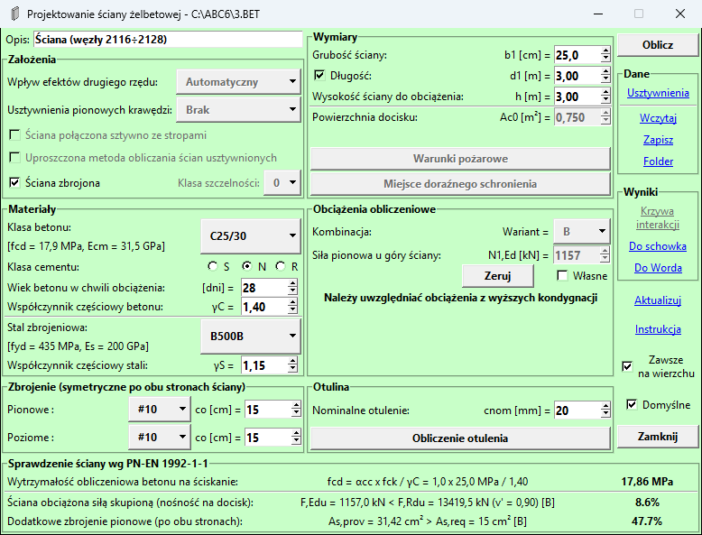

**Ramka przycisków po prawej** stronie zawierająca następujące funkcje:
- Przycisk `Oblicz` aktualizuje część z wynikami dla zadanych wartości.
- Przycisk `Usztywnienia` otwiera ponownie wcześniej opisane okno
[Usztywnienia](#usztywnienia).
- Przycisk `Wczytaj` umożliwia otwarcie pliku zadania (z końcówką *.MUR* w przypadku
ścian murowych, *.BET* w przypadku ścian żelbetowych) w celu wczytania wcześniej
zapisanych danych.
- Przycisk `Zapisz` pozwala na zapisanie danych do pliku (z końcówką *.MUR* w
przypadku ścian murowych, *.BET* w przypadku ścian żelbetowych) w wybranej lokalizacji
na dysku.
- Przycisk `Folder` pozwala określić domyślny folder do wczytywania i zapisywania
plików z danymi.
- Przycisk `Do schowka` kopiuje listę z notką obliczeniową do schowka. Po zamknięciu
modułu schowek zostaje wyczyszczony.
- Przycisk `Do Worda` otwiera nowy dokument zawierający notkę obliczeniową. Ponowne
naciśnięcie przycisku powoduje dopisanie wyników do otwartego dokumentu. W przypadku
posiadania innego pakietu niż *Microsoft Office*, jest tworzony i otwierany
nowy plik *Nazwa_zadania.MUR.DOCX* lub *Nazwa_zadania.BET.DOCX* w lokalizacji zadania.
- Przycisk `Aktualizuj` sprawdza, czy jest uruchomiona aktualna wersja pakietu oraz w
razie potrzeby umożliwia pobranie i aktualizację do najnowszej wersji. Plik instalacyjny
jest pobierany w tle, trzeba poczekać na jego pobranie. Następnie moduł jest wyłączany
i uruchamia się instalacja. Zaleca się zamknięcie programu **ABC** przed instalacją.
Pomarańczowy kolor czcionki przycisku sygnalizuje, że jest dostępna aktualizacja.
- Przycisk `Instrukcja` otwiera niniejszą stronę internetową z instrukcją modułu.
- Przycisk `Zamknij` zapisuje wyniki i zamyka moduł, skąd można przejść do wyboru
kolejnego miejsca.
- Przełączanie opcji `Zawsze na wierzchu` powoduje przypięcie lub odpięcie modułu ponad
innymi oknami (domyślnie włączony przy uruchamianiu z programu **ABC**).
- Zaznaczenie opcji `Domyślne` powoduje, że po zamknięciu modułu bieżące ustawienia
zostają zapisane jako domyślne do wymiarowania kolejnych miejsc.

